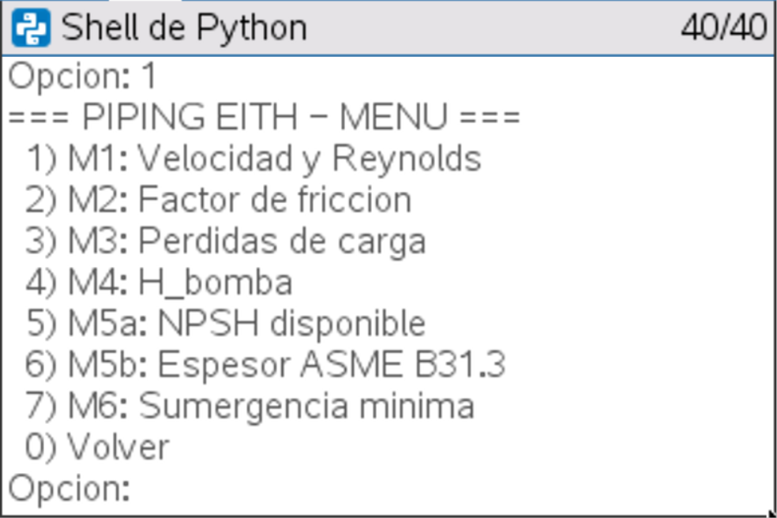
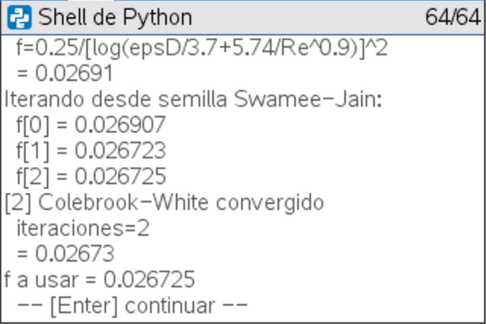
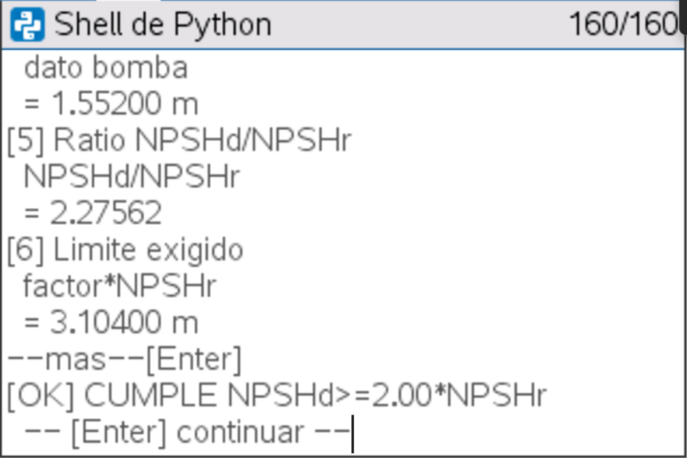
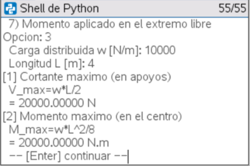
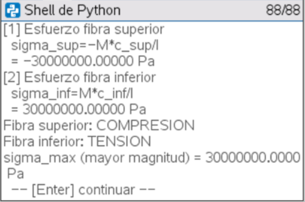
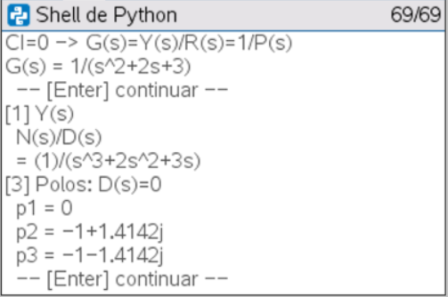
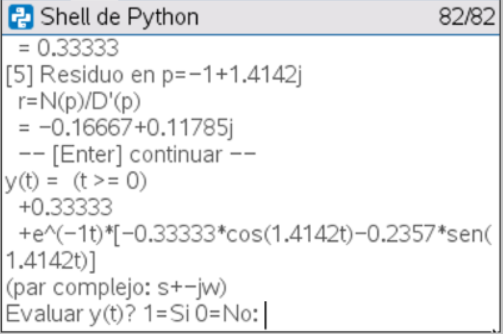

# Herramientas de cálculo para TI-Nspire CX II

Programas en MicroPython para la calculadora TI-Nspire CX II que resuelven
problemas de ingeniería mecánica **paso a paso**: cada resultado se muestra con
su fórmula, su valor y su unidad, en el orden en que se desarrolla a mano.

| Programa | Área | Qué resuelve |
|---|---|---|
| `piping.py` | Mecánica de fluidos | Sistema de bombeo y turbinas (8 módulos encadenables) |
| `esfuerzos_vigas.py` | Resistencia de materiales | Sección, corte y momento máximos, esfuerzo por flexión y cortante |
| `laplace.py` | Control automático | Transformada de Laplace de una EDO, fracciones parciales y respuesta en el tiempo |

## piping.py

| Módulo | Cálculo |
|---|---|
| M1 | Velocidad, Reynolds, rugosidad relativa y régimen |
| M2 | Factor de fricción: Swamee-Jain y Colebrook-White iterado, con su convergencia |
| M3 | Pérdidas por fricción (Darcy-Weisbach) y singulares, por tramo o del sistema |
| M4 | Altura de bomba por Bernoulli, con casos extremos de nivel |
| M5a | NPSH disponible y comparación con el requerido |
| M5b | Espesor mínimo de tubería según ASME B31.3 |
| M6 | Sumergencia mínima |
| — | Altura neta de turbinas de acción y de reacción |

Los módulos se encadenan: M3 puede calcular la velocidad y el factor de
fricción llamando a M1 y M2, sin volver a escribir los datos.

Ejemplo (M1, succión de 6" con 56 m³/h de agua):

```
=== M1: VELOCIDAD Y REYNOLDS ===
Datos del tramo:
  Caudal Q [m3/h]: 56
  Diametro interior D [m]: 0.15408
  Rugosidad eps [m][0.0003]:
  Visc. cinematica nu [m2/s][1.022e-06]:
[1] Caudal en m3/s
  Q=Q_h/3600
  = 0.01556 m3/s
[2] Area
  A=pi*D^2/4
  = 0.01865 m2
[3] Velocidad
  v=Q/A
  = 0.83426 m/s
[4] Reynolds
  Re=v*D/nu
  = 125776.20283
[5] Rugosidad relativa
  eps/D
  = 0.00195
[6] Regimen TURBULENTO
```

En la calculadora (capturas del emulador de TI-Nspire CX Student Software, con
los datos del proyecto EITH):

| Menú de piping | M2: fricción en la descarga | M5a: NPSH con la bomba 1 m más abajo |
|---|---|---|
|  |  |  |

M2 parte de Swamee-Jain como semilla y converge con Colebrook-White en 2
iteraciones (f = 0,026725, igual al notebook del proyecto). M5a verifica
NPSH_d = 3,532 m ≥ 2·NPSH_r = 3,104 m.

## esfuerzos_vigas.py

- **M1:** propiedades de la sección (rectangular, circular o datos directos).
- **M2:** corte y momento máximos para 7 casos estándar de viga simple y en
  voladizo (carga puntual, distribuida o momento en el extremo).
- **M3:** esfuerzo por flexión σ = −M·c/I, con fibra superior e inferior y
  tracción o compresión.
- **M4:** esfuerzo cortante τ = V·Q/(I·b), con atajos para secciones
  rectangular y circular.

Usa la convención de signos de Philpot y unidades SI base (m, N, Pa).

Viga simplemente apoyada con carga distribuida w = 10 kN/m, L = 4 m y sección
rectangular de 100 × 200 mm (M3 encadena M2 y M1):

| M2: corte y momento máximos | M3: esfuerzo por flexión |
|---|---|
|  |  |

## laplace.py

La calculadora no hace álgebra simbólica, así que el programa recorre con
números el camino de un ejercicio típico:

- **M1:** tabla de pares de la transformada (Ogata, tabla 2-1).
- **M2:** de la EDO a Y(s).
- **M3:** fracciones parciales y y(t), para denominadores de grado ≤ 3 con
  polos simples.
- **M4:** respuesta de sistemas de primer y segundo orden, y teoremas del
  valor inicial y final, que cubren los casos de polo doble.

EDO y'' + 2y' + 3y = escalón unitario, con condiciones iniciales nulas (M3
encadena M2): Y(s) = 1/(s³ + 2s² + 3s), con un polo en 0 y un par complejo
−1 ± 1,4142j, que el programa convierte en seno y coseno.

| M3: Y(s) y sus polos | M3: respuesta y(t) |
|---|---|
|  |  |

## Cómo se escribieron

Los tres programas siguen el mismo estándar:

- **Pantalla paginada:** la salida se pausa cada 9 líneas para que quepa en la
  pantalla de la calculadora, sin cortar los menús a la mitad.
- **Entrada robusta:** acepta coma o punto decimal y el signo menos de la
  calculadora, y vuelve a preguntar si el dato no es válido.
- **Paso a paso:** cada paso numerado muestra descripción, fórmula, resultado y
  unidad, y las verificaciones se marcan como `[OK]` o `[FALLA]`.
- **Módulos que devuelven todos sus resultados** (un diccionario), para que
  otro módulo pueda reutilizarlos.

Se verificaron en el PC con Python 3 contra casos resueltos: el módulo de
Laplace, con 44 casos y 30 pares integrados numéricamente.

## Uso

En la calculadora: abre el `.py` en TI-Nspire CX Student Software, guárdalo
como documento `.tns` y envíalo a la calculadora. Ejecuta el programa desde el
editor de Python.

En el PC (para probar): `python piping.py`.

**Nota:** `piping.py` usa Re = 2300 como límite del régimen laminar (valor de
White); la [calculadora web de bombeo](https://github.com/Fflores96/calculadora-bombeo)
usa 2000, que es el que da Mott. Es una diferencia real entre textos, no un
error.

## Autor

Felipe Flores Díaz, estudiante de Ingeniería en Ejecución Mecánica,
Universidad de Santiago de Chile.
